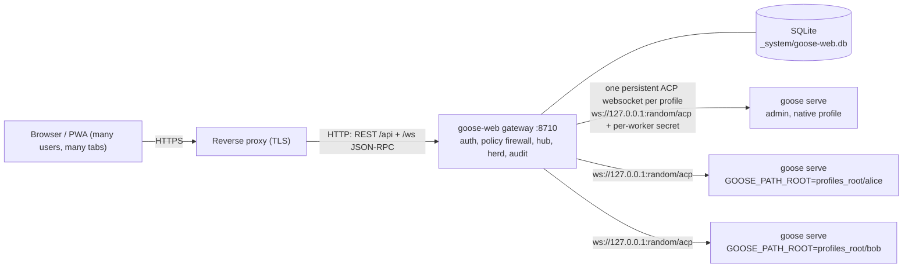

# Goose AI Web Interface

**One Goose install on one machine, shared by many people through the browser.**

goose-web is a multi-user web front end and gateway for the [Goose](https://github.com/aaif-goose/goose) AI agent.
It runs `goose serve` workers on the machine where Goose is already installed and gives every user a browser UI for
it, on a desktop or a phone.

- **Each person gets an isolated Goose profile.** Their worker runs with `GOOSE_PATH_ROOT=<profiles_root>/<user>`,
  so their chats, recipes, skills, extensions, providers and secrets stay in their own folder. All workers run as
  the same OS account, and each non-admin user's worker runs in its own Windows AppContainer sandbox.
- **The admin keeps their native Goose profile.** The admin is bound to the existing Goose profile (for example
  `%APPDATA%\Block\goose`) with all of its chats, recipes and settings. Nothing gets copied around, and Goose
  Desktop keeps working on the same profile.

`goose-web 1.13.0` - Python 3.11+ - Windows 10/11 and Windows Server 2019+ - Apache-2.0

## Windows only

Goose Web currently runs on **Windows only** (Windows 10/11 and Windows Server 2019 or later); `goose-web serve`
refuses to start on other systems. The reason is the sandbox: on Windows each non-admin user's agent runs in its own
AppContainer, so the operating system enforces the folder boundaries between users and blocks loopback
([ADMINISTRATION 11.6](docs/ADMINISTRATION.md)). Linux and macOS have no equivalent per-user sandbox in Goose Web
yet, so team members there would share one OS account with full access to each other's files (the accepted risk
GW-01, [SECURITY-ASSESSMENT 7.2](docs/SECURITY-ASSESSMENT.md)).

Linux and macOS support, and Docker, may return once a sandbox exists for them (candidates: Linux user namespaces
with bubblewrap, or one OS account per user; macOS sandbox profiles). Releases up to 1.12.0 in the git history still
contain the Linux/macOS installer and the Docker files, but they are unsupported.

## Features

- **Chat**: streaming responses, tool calls, and tool-permission cards (approve or deny, first answer wins across
  all your tabs). Recipe parameters and elicitation forms. Mode, provider, model and thinking-effort switching, also
  on the New chat screen before the first message. File upload into your
  workspace.
- **Live activity** (as in Goose Desktop): the model's thinking, every tool call with its input, live output
  and result, and a live bar with the current step, tool-call count and elapsed time. How much stays open is a
  per-user preference.
- **Sessions grouped by folder** (as in Goose Desktop), with pinning, search, rename, archive and fork.
- **Recipes, skills, schedules, MCP Apps and extensions**, each with its own page. MCP Apps run in a sandboxed
  frame at an opaque origin, both standalone and **inline in the chat** when a tool has an app UI (as in Desktop).
- **Extension status** in every chat: "N/M extensions" in the header, with a warning and the error text when one
  fails to start, and Retry.
- **Live sync with Goose Desktop, the CLI and schedules**: a chat continued elsewhere refreshes in the open web chat
  within about 2 seconds, and the session list re-sorts.
- **Settings**: providers and models, system prompts, goose hints, tool permissions, preferences, themes,
  notifications, account security.
- **Team profiles with least privilege**: each user belongs to one team, and the team decides their experience:
  allowed providers, models and approval modes (nothing until you allow it, or Any), a default model, permissions
  (shell, extensions, providers, schedules, config...), a shared team folder, extra folders and concurrency limits.
  Team recipes, skills, extensions and providers are provisioned into members' profiles. Users without a team can
  sign in but cannot chat.
- **Shared hints library**: hints documents assigned to teams or users. Team hints come last and take precedence;
  personal hints are used only when the team allows them, and hints files in working folders are ignored.
- **Sign-in**: local accounts, LDAP/Active Directory, OpenID Connect, optional TOTP two-factor (admins can reset it
  when a user loses their authenticator), API tokens for automation.
- **Audit log** of sign-ins, admin changes, impersonation and sensitive agent calls.
- **Herd dashboard** (inspired by [herdr.dev](https://herdr.dev)): every live agent with its status (working,
  needs you, done, error), so you see which agent needs you. Agents keep running after you close the tab, because
  the gateway owns the Goose connection. Reopening a chat replays it. Peers let you watch agents on other machines.
- **Windows ownership safety**: the gateway refuses to run elevated and relaunches itself with a normal-user token.
  It has an ownership check for profile files and an elevation audit of the host's scheduled tasks.
- **PWA**: installable, with browser notifications, an optional sound, and per-user webhooks (Slack/Teams/ntfy
  style) for "needs you", "done" and "error".

## Architecture



- The browser talks JSON-RPC over `/ws`. The hub rewrites request ids and holds **one** upstream ACP connection
  per profile, shared by all of that user's tabs. A closed tab never cancels a run.
- Workers start on first use, on loopback, with a random port and a random secret. They stop when idle and restart
  with backoff after a crash. On Windows a kill-on-close Job Object ties them to the gateway.
- Every non-admin ACP call goes through a default-deny method firewall (`goose_web/policy.py`).

REST and WebSocket contract: [docs/API.md](docs/API.md).

## Documentation

| Guide | For |
|---|---|
| [docs/USER-GUIDE.md](docs/USER-GUIDE.md) | Everyone who signs in: every screen, chat, live activity, recipes, schedules, settings |
| [docs/ADMINISTRATION.md](docs/ADMINISTRATION.md) | Whoever runs the gateway: install, users, teams, policies, backups, upgrades |
| [docs/CONFIGURATION.md](docs/CONFIGURATION.md) | Every configuration key |
| [docs/TROUBLESHOOTING.md](docs/TROUBLESHOOTING.md) | Symptom, cause and fix |
| [docs/ARCHITECTURE.md](docs/ARCHITECTURE.md) | Developers: how it works inside |
| [docs/API.md](docs/API.md), [docs/acp-reference.md](docs/acp-reference.md) | REST/WebSocket contract and the Goose ACP methods used |
| [docs/SECURITY-ASSESSMENT.md](docs/SECURITY-ASSESSMENT.md), [SECURITY.md](SECURITY.md) | Threat model, findings, how to report a vulnerability |
| [CHANGELOG.md](CHANGELOG.md) | What changed in each release, and security fixes to upgrade for |

## Deployment

goose-web is installed natively on Windows. The gateway runs in a Python virtual environment next to the Goose you
installed yourself, and you update Goose yourself as usual. The admin can share the existing Goose Desktop profile
(`%APPDATA%\Block\goose`), so Desktop and the browser see the same chats, recipes and settings. The installer
installs the Python dependencies from the hash-locked `requirements.lock` (`pip install --require-hashes`), and then
goose-web itself with `--no-deps`.

## Quick start

You need Goose 1.50 or later (the `goose` CLI, or Goose Desktop, which bundles it; every release since 1.50.0 is tested; a few
features need 1.51-1.55, see [ADMINISTRATION 11.7](docs/ADMINISTRATION.md)) and Python 3.11+ or [uv](https://docs.astral.sh/uv/).

There is no default password. `goose-web init` creates the first admin with a **random initial password and prints
it once**. The installer shows it at the end of its output. Store it, sign in, and choose a new password (the
change is enforced). If you lose it, reset it with `goose-web user reset NAME`, which prints a new temporary
password.

From a **normal, non-elevated** PowerShell in the repository folder (the installer refuses to run elevated):

```powershell
powershell -ExecutionPolicy Bypass -File scripts\install.ps1
scripts\start-gateway.cmd          # or sign out and in again: the logon task starts it
```

Then open <http://127.0.0.1:8710> and sign in as **your Windows user name (`%USERNAME%`)** with the initial
password the installer printed at the end. You must change it right away.

- The admin profile is found automatically at `%APPDATA%\Block\goose`. If it is not there, the installer asks for
  the folder. If you leave the answer empty, you get a fresh profile in `C:\Goose_Web_Profiles\appdata`.
- The installer registers a logon task (runs as you, non-elevated) and a firewall rule through **one** elevation
  prompt. Use `-NoService` to skip that.
- LAN or reverse proxy example (gateway host `192.168.1.10`, proxy `192.168.1.2`):
  `scripts\install.ps1 -BindHost 192.168.1.10 -PublicUrl https://goose.example.org -TrustedProxy 192.168.1.2 -FirewallRemoteAddress 192.168.1.2`

## Reverse proxy

Terminate TLS at a reverse proxy. The gateway has no TLS of its own. Caddy example (it proxies WebSockets and
sets `X-Forwarded-*` by default):

```
goose.example.org {
    reverse_proxy 192.168.1.10:8710
}
```

Then tell the gateway its public URL and trust only the proxy:

```yaml
# <profiles_root>/_system/config.yaml
server:
  host: "192.168.1.10"
  public_url: "https://goose.example.org"   # Secure __Host- cookie, HSTS, Origin checks, OIDC redirects
  trusted_proxies: ["127.0.0.1", "::1", "192.168.1.2"]
```

Limit the gateway port to the proxy in the firewall (`register-service.ps1 -FirewallRemoteAddress <proxy ip>`).
The gateway accepts only allow-listed Host headers (the `public_url` host, `localhost`, `127.0.0.1`, `::1`, the bind
address and `server.allowed_hosts`). With `public_url` set, browser origins come from it. If you also open the
gateway directly, for example at `http://192.168.1.10:8710`, add that origin to `server.allowed_origins`. Single
sign-on (OIDC) needs `public_url`.

## Configuration

Settings come from built-in defaults, then `config.yaml` (`--config`, `GOOSE_WEB_CONFIG` or
`<profiles_root>/_system/config.yaml`), then environment variables `GOOSE_WEB__SECTION__KEY`. Sign-in methods,
branding, peers and policies are managed in the admin UI. `goose-web check` diagnoses a setup.

Every key, the CLI, policies, profile layout, scheduler rules and scripts are described in
[docs/CONFIGURATION.md](docs/CONFIGURATION.md).

## Security

- Passwords are hashed with scrypt. Session and API tokens are random and stored as hashes. Cookies are HttpOnly and
  SameSite=Strict (`__Host-`/Secure behind HTTPS).
- Writes need a CSRF header plus an Origin check, and the WebSocket checks the Origin. The Host header is
  allow-listed (DNS-rebinding guard). The CSP is strict.
- No default password: the first admin gets a random password that is shown once, and must change it at first
  sign-in.
- Strong passwords are enforced (12+ characters, all four character classes, no common passwords); passwords set by
  an admin must be changed at the next sign-in. Sign-in is rate limited with an account lockout, and a client address
  is blocked after 10 failed sign-ins in a row within 30 days (Admin > Blocked addresses, `goose-web ip unblock`). TOTP (with replay protection), LDAP/AD (TLS required by default) and OIDC
  (accounts bound to issuer + subject) are supported. API tokens are sent only in the `Authorization` header.
- Non-admins go through a default-deny ACP firewall with folder confinement (symlinks resolved). Shell extensions
  are off unless `allow_shell` is set. MCP Apps can only call tools of their own extension.
  Their agents run in their own Windows AppContainer (on by default), which limits them to their folders and
  closes loopback.
- HTTPS out of the box: a built-in local CA and server certificate for every local name and address, renewed
  automatically; or your own certificate; or off behind a reverse proxy (Admin > System > HTTPS).
- Every user action is attributable (user, client address, time): sign-ins, admin changes, agent calls and everyday
  chat activity, in the audit log and a JSON-lines activity log. All logs stay under 0.5 % of the disk.
- Workers listen on loopback only, each with its own secret. The gateway never runs elevated.
- Personal webhooks cannot reach internal addresses unless `notify.allow_private_targets` is turned on.
- Dependencies are installed from a hash-locked `requirements.lock`.

Full threat model and findings: [docs/SECURITY-ASSESSMENT.md](docs/SECURITY-ASSESSMENT.md). To report a
vulnerability, see [SECURITY.md](SECURITY.md).

## Limitations

- **Without the sandbox, profile isolation is a privacy boundary, not a hard security boundary.** All workers run
  as one OS user. The AppContainer sandbox (on by default) confines non-admin users' agents; without it, a tool that
  can read files or run commands can reach other profiles. That is why the shell/developer extensions are
  off for non-admins unless their policy sets `allow_shell`. Admins have the full power of that OS account.
  Team folders and team policies are enforced by the gateway, not by OS permissions, so keep Shell and raw config
  editing off for non-admin teams.
- **Home-folder skill and recipe folders are shared.** `~/.agents/skills`, `~/.agents/recipes` and similar folders
  are not moved by `GOOSE_PATH_ROOT` and are visible to all profiles.
- **One scheduler per profile.** Goose Desktop and the gateway must not both run the scheduler for the native
  profile, or jobs fire twice. `native_scheduler: auto` (the default) runs it in the gateway only while Desktop is
  closed.
- There is no built-in TLS: use a reverse proxy.

## Development

```bash
uv venv
uv pip install --require-hashes -r requirements.lock   # the locked runtime dependencies
uv pip install --no-deps -e .
uv pip install pytest pytest-asyncio
python -m pytest             # use the venv's python: .venv\Scripts\python -m pytest on Windows
```

The tests need no Goose: the hub tests use a fake ACP agent. Code lives in `goose_web/` (Starlette + uvicorn, SQLite)
and a build-free ES-module SPA in `goose_web/static/` (vendored libraries listed in
[goose_web/static/vendor/README.md](goose_web/static/vendor/README.md), checked against `SHA256SUMS` by the
tests). When you change dependencies in `pyproject.toml`, regenerate the lock file with
`pip-compile --generate-hashes --strip-extras -o requirements.lock pyproject.toml`.

## Contributing

Issues and pull requests are welcome. Please run `python -m pytest` before you open a pull request, and add tests
for behaviour you change. Report security problems privately as described in [SECURITY.md](SECURITY.md), not
in a public issue.

## License

[Apache License 2.0](LICENSE). Copyright 2026 Goose AI Web Interface contributors.
